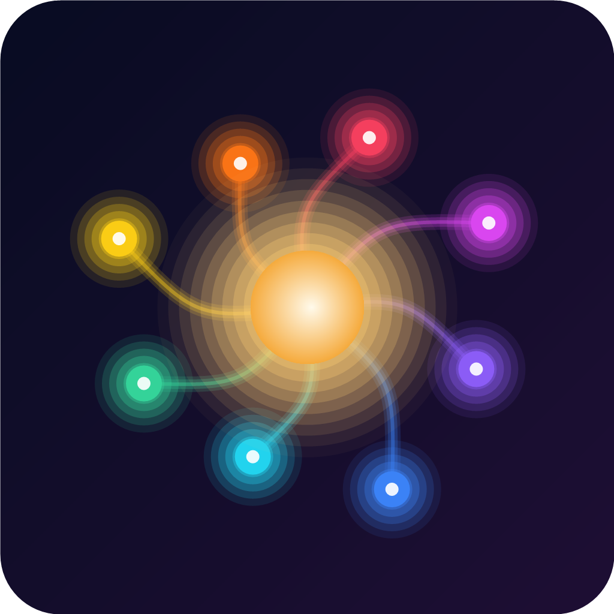
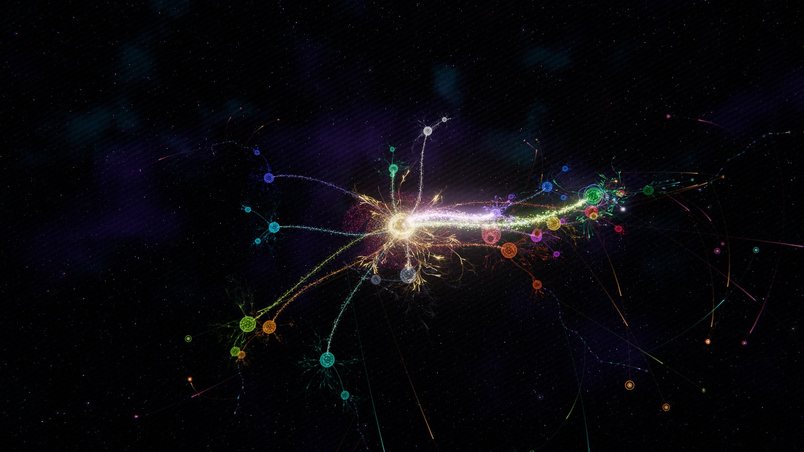
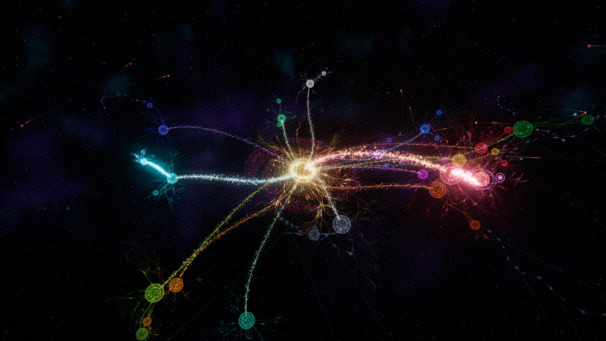
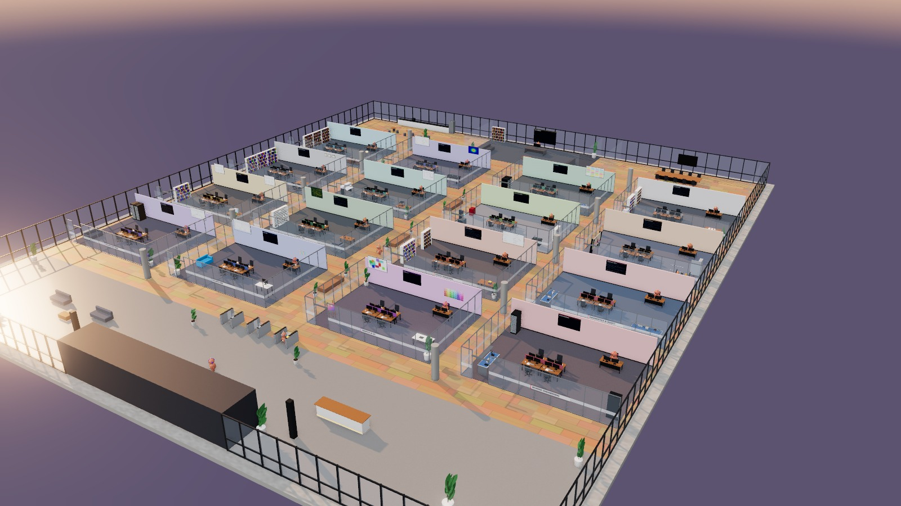
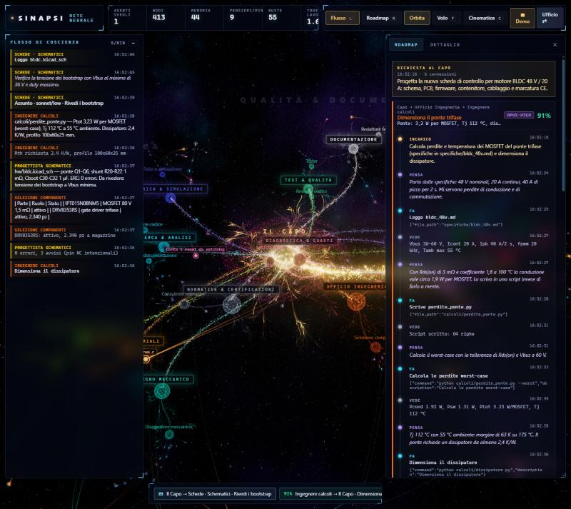
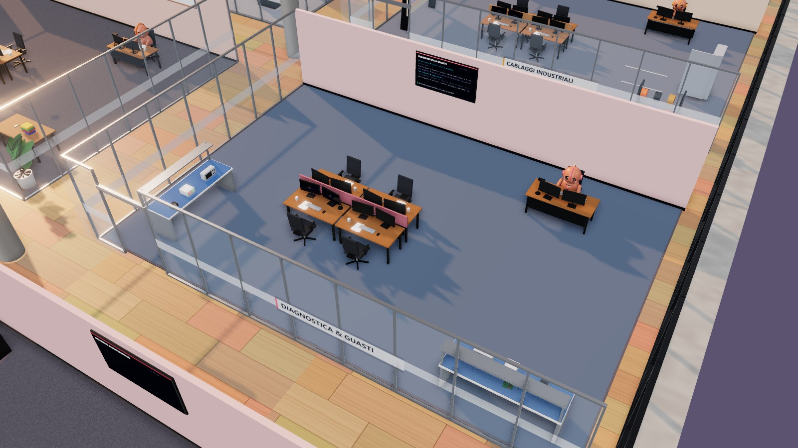
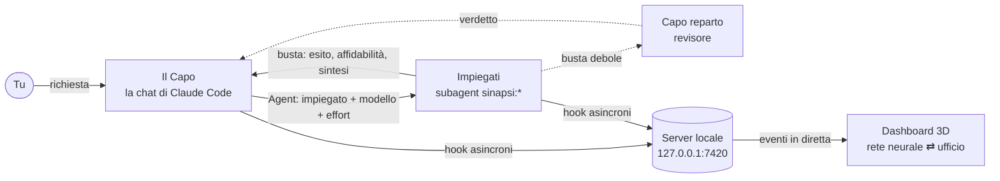

<div align="center">



# Sinapsi

**Un'azienda di agenti specializzati dentro Claude Code, da guardare dal vivo in 3D.**

La chat diventa **il Capo**: per ogni incarico sceglie l'impiegato giusto, il modello e l'effort.
Il lavoro di 25 agenti, divisi in 16 reparti, si vede mentre accade, come **rete neurale** o come **ufficio**.

[](https://github.com/Samuk734/sinapsi/actions/workflows/test.yml)


[](LICENSE)




</div>

## Cos'è

Sinapsi è un **plugin per Claude Code** che contiene tre cose:

- **La skill del Capo** (`/sinapsi:apri`). Trasforma la chat in un direttore che delega con criterio: chi chiamare, con quale modello (Haiku, Sonnet, Opus, Fable) e con quale effort.
- **25 impiegati**, cioè subagent con prompt e strumenti pensati per un mestiere preciso. Non hanno un modello fisso: lo sceglie il Capo a ogni chiamata, insieme all'effort. Coprono software, web, grafica, reverse engineering, schematici, PCB, calcoli, diagnostica, normative CE, disegno meccanico, meccanica di precisione, cablaggi industriali, fisica, test e documentazione.
- **Una dashboard locale in 3D**, alimentata dagli hook di Claude Code. Mostra ogni pensiero, azione e consegna **senza consumare token**.

Ogni impiegato chiude il lavoro con una **busta** che contiene esito, sintesi e **indice di affidabilità**. Le buste solide vanno dritte al Capo; quelle deboli passano prima dal capo reparto, che le verifica. Al Capo arriva solo la sintesi: il lavoro sporco resta fuori dal suo contesto.

## Le due viste

<table>
<tr>
<td width="50%"></td>
<td width="50%"></td>
</tr>
<tr>
<td><b>Rete neurale.</b> Il Capo è il nucleo, i reparti sono gangli, gli impiegati neuroni che si svegliano quando vengono chiamati. Ogni pensiero, azione e risultato fa crescere un ramo; ogni file o fonte toccata diventa un nodo di memoria condiviso. Clicca un impulso in volo per intercettare la busta. Si naviga in orbita, in volo libero (<kbd>F</kbd>) o in modalità cinematica (<kbd>C</kbd>).</td>
<td><b>Ufficio.</b> Un piano open space con 16 stanze vetrate, ognuna arredata col suo mestiere: banchi di laboratorio con oscilloscopio, telaio cablaggi, fresa, tavolo ottico, rack server. I mini Claude arrivano in ascensore, timbrano al tornello, lavorano con la nuvoletta di stato sopra la testa e consegnano buste colorate in base all'affidabilità. Gli schermi mostrano il lavoro dal vivo.</td>
</tr>
<tr>
<td></td>
<td></td>
</tr>
<tr>
<td><b>Roadmap e Dettaglio</b> (<kbd>R</kbd>). Ogni connessione Capo → reparto → impiegato con il ragionamento completo: incarico, pensieri, azioni, risultati, busta ed eventuale revisione. Il <b>flusso di coscienza</b> (<kbd>L</kbd>) scorre a lato.</td>
<td><b>Un reparto da vicino.</b> Clicca su un impiegato per seguirlo e leggere cosa sta pensando; clicca un'insegna per volare nella stanza. Con <kbd>F</kbd> cammini nell'ufficio ad altezza di mini Claude.</td>
</tr>
</table>

## Installazione

### Requisiti

| Cosa | Versione | A cosa serve |
|---|---|---|
| **[Claude Code](https://code.claude.com)** | 2.1.292 o successiva (provato con la 2.1.317) | Il Capo e gli impiegati. Dalla 2.1.292 si può scegliere l'effort a ogni chiamata. |
| **[Node.js](https://nodejs.org)** con npm | 20 o successiva (npm è incluso nell'installer) | Il server locale della dashboard e i sensori. |
| **[Git](https://git-scm.com)** | qualsiasi recente | Claude Code lo usa per scaricare il plugin da GitHub. |
| **Browser con WebGL 2** | Chrome, Edge o Firefox recenti | La dashboard 3D. Basta una grafica integrata; l'ufficio, con ombre e occlusione ambientale, è la vista più pesante. |
| **Connessione a internet** | solo al primo avvio | Scarica three.js da npm, circa 30 MB. |
| **Porta 7420 libera** | | La dashboard su `http://localhost:7420`. Si cambia con la variabile `SINAPSI_PORT`. |

**Modelli**: per usare tutto l'organico il tuo account Claude deve avere accesso a Haiku, Sonnet, Opus e Fable. Il consumo resta quello del tuo piano: la dashboard non fa chiamate al modello.

**Sistema operativo**: provato su Windows 10. macOS e Linux sono supportati dal codice ma non ancora collaudati.

Per controllare cosa hai già, in un terminale:

```bash
claude --version
```
```bash
node --version
```
```bash
git --version
```

### Installare il plugin

In una sessione di Claude Code:

```
/plugin marketplace add Samuk734/sinapsi
```
```
/plugin install sinapsi@sinapsi
```

Riavvia la sessione. Poi, in qualsiasi progetto, scrivi **"apri Sinapsi"** oppure `/sinapsi:apri`. La prima volta la dashboard scarica la grafica 3D (three.js, circa 30 MB) e si apre nel browser su `http://localhost:7420`.

<details>
<summary><b>Provarlo senza installarlo</b></summary>

```bash
git clone https://github.com/Samuk734/sinapsi.git
cd sinapsi
npm install
npm run demo
```

Apri `http://localhost:7420`: un simulatore fa lavorare l'azienda su due progetti di esempio, senza usare Claude. Per caricare il plugin solo in una sessione, senza installarlo: `claude --plugin-dir ./sinapsi`.
</details>

## Come funziona



- **Il Capo decide** con le regole della skill: quando delegare e quando fare da solo, quanti agenti in parallelo, quale modello ed effort, come salire di livello se un tentativo fallisce. Le regole vengono dalle linee guida di Anthropic e da progetti pubblici: vedi [docs/ricerca-routing.md](docs/ricerca-routing.md).
- **Il modello lo sceglie davvero il Capo**: gli impiegati non ne hanno uno proprio, e un sensore respinge ogni chiamata a un impiegato Sinapsi senza `model`. Il Capo riceve il motivo e ripete la chiamata scegliendo.
- **I sensori della dashboard non rallentano Claude**: sono asincroni, girano in background e, se la dashboard è chiusa, terminano subito.
- **Il pensiero** degli impiegati si legge dalle loro trascrizioni locali, quando Claude Code lo registra.

### Il risparmio di token, onestamente

Delegare **non** riduce i token totali: un sistema multi-agente ne usa di più. Sinapsi punta a tre cose:
1. **Contesto del Capo pulito**: letture, log e tentativi restano negli impiegati. Il Capo riceve solo buste brevi, e così una sessione lunga resta lucida più a lungo.
2. **Il modello giusto per ogni lavoro**: Haiku per cercare e lanciare i test, Opus o Fable solo dove servono davvero.
3. **Zero token per la grafica**: tutto ciò che vedi nasce dagli hook, non da chiamate al modello.

La dashboard mostra i token di lavoro e quanti sono rimasti **fuori dal contesto del Capo**.

| Costo | Token (stima di `claude plugin details`) |
|---|---|
| Fisso per ogni sessione (descrizioni di skill e agenti) | ~1.600 |
| Aprire Sinapsi (istruzioni del Capo) | ~4.200 |
| Ogni impiegato chiamato (il suo prompt) | ~750–950 |

## L'organico

| Area | Reparti |
|---|---|
| **Digitale** | Sviluppo Software (embedded, applicativo, architetto) · Sviluppo Web (frontend, backend) · Grafica & UX · Reverse Engineering |
| **Elettronica** | Schede · Schematici · Schede · PCB · Ufficio Ingegneria (calcoli, selezione componenti) · Diagnostica & Guasti · Normative & Certificazioni |
| **Meccanica** | Disegno Meccanico · Meccanica di Precisione · Cablaggi Industriali |
| **Scienza** | Ricerca & Analisi (esploratore codice, documentalista) · Fisica & Simulazione |
| **Qualità** | Test & Qualità (tester, revisore) · Documentazione |

Ogni reparto ha un **capo reparto** che verifica le buste sotto soglia. L'organico sta in [`roster/azienda.json`](roster/azienda.json), con il modello e l'effort consigliati per ogni impiegato: sono un punto di partenza per il Capo, non valori fissi. I prompt sono in [`roster/agenti/`](roster/agenti).

**Posizioni aperte.** Quando manca uno specialista che servirebbe spesso, il Capo pubblica una posizione aperta nella dashboard. Se sei d'accordo, lo forma: scrive un nuovo impiegato nel progetto, oppure in `~/.claude/agents/` per averlo in tutti i progetti.

## Privacy e sicurezza

- **Tutto locale**: il server ascolta solo su `127.0.0.1` e nessun dato esce dal tuo computer. L'unico download è la libreria three.js da npm, al primo avvio.
- **Disinstallazione**: per togliere tutto basta `/plugin uninstall sinapsi`.
- **Reverse engineer**: l'impiegato di reverse engineering eredita gli strumenti della sessione, così può usare server MCP come IDA o REA se li hai. Usalo solo su materiale che hai il diritto di analizzare.

## Stato del progetto

**0.1.1 beta.** Cosa è verificato:
- la logica è coperta da test: traduzione degli hook, instradamento delle buste, componenti del plugin;
- il plugin supera `claude plugin validate`;
- le due viste girano sul simulatore.

Ancora da fare:
- [ ] collaudo su sessioni reali: i campi degli hook seguono la documentazione ufficiale, ma il formato delle trascrizioni è interno a Claude Code e può cambiare;
- [ ] ecosistema per progetto: storico, memoria e organico salvati in `.sinapsi/` dentro ogni progetto;
- [ ] formazione dei nuovi impiegati direttamente dalla dashboard;
- [ ] tracciare anche le riprese degli agenti con `SendMessage`.

## Struttura

```
.claude-plugin/   manifest del plugin e del marketplace, icona
skills/apri/      la skill del Capo           (generata da roster/skill.template.md)
agents/           i 25 impiegati              (generati da roster/agenti + contratto della busta)
hooks/            i sensori: emit.js (verso la dashboard) e scelta-modello.js (niente chiamate senza modello)
server/           server locale, traduttore degli hook, lettore delle trascrizioni, simulatore
public/           la dashboard: rete neurale e ufficio (three.js)
bin/sinapsi.js    CLI: avvia, stato, demo, posizione-aperta
roster/           organico, prompt e contratto: modifica qui, poi npm run build
docs/             architettura e ricerca sulle regole di scelta
```

**Sviluppo**: `npm test` controlla che i file generati siano aggiornati ed esegue i test; `npm run build` rigenera skill e agenti dopo una modifica al roster. L'architettura e il formato degli eventi sono descritti in [docs/architettura.md](docs/architettura.md).

## In English

Sinapsi is a **Claude Code plugin** that turns your chat into "the Boss" of a company of 25 specialized subagents across 16 departments. The departments cover software, web, UX, reverse engineering, schematics, PCB, engineering calculations, diagnostics, CE compliance, mechanical design, precision mechanics, industrial wiring, physics, QA and docs. For each task the Boss picks the agent, the model and the effort: agents have no fixed model, and a hook rejects any call to a Sinapsi agent that doesn't pass one. Every step streams, at zero token cost, into a local 3D dashboard that you can view as a **neural network** or as a **themed office** with little Claude employees. Agents hand back an "envelope" with a self-reported reliability score; weak ones go through a department reviewer first.

The UI and the prompts are in Italian.

Requirements: Claude Code 2.1.292 or later, Node.js 20 or later with npm, Git, a WebGL 2 browser, and internet access on the first launch. Install it with `/plugin marketplace add Samuk734/sinapsi`, then `/plugin install sinapsi@sinapsi`, and say "apri Sinapsi". To try the dashboard without Claude: `npm install && npm run demo`.

## Licenza

[MIT](LICENSE) © 2026 Samuk734. La grafica usa [three.js](https://threejs.org) (MIT).
